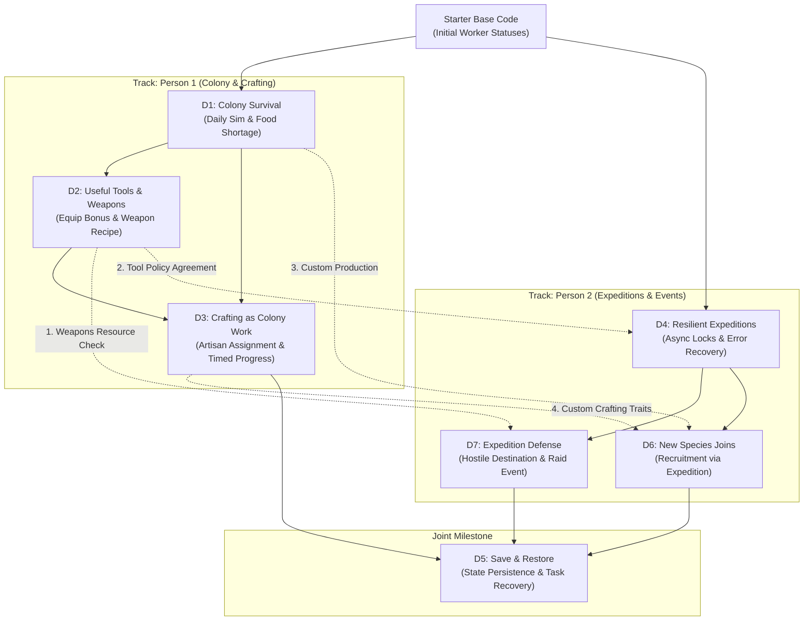

# Dwarfhold Requirement Dependencies & Branching Strategy

This document outlines the dependencies between project requirements (D1–D7), identifying which tasks are tightly coupled, which can be developed in parallel across different branches, and the recommended sequence of execution.

---

## Dependency Map



---

## 1. Tightly Coupled Requirements

Certain requirements have functional or conceptual dependencies and should be sequenced carefully:

* **Parallel Independence of D1 & D4 (Day 1):**
  * D1 and D4 both branch directly from the starter codebase without blocking each other. D1 addresses the daily 8-second simulation tick and starvation consequences in `simulation.ts`, while D4 addresses the async network calls, error recovery, and worker locking in `ColonyProvider.tsx` and `server/index.js`.
* **D1 (Worker Availability) $\rightarrow$ D3 (Crafting as Colony Work):**
  * Crafting requires an available worker who is removed from local production while crafting. D3 directly relies on the availability invariants established in D1.
* **D2 (Weapons) $\rightarrow$ D7 (Colony Defense):**
  * D7 specifically requires checking a colony weapon threshold crafted via D2's weapon recipe. D7's defense condition cannot be satisfied without the weapon resource introduced in D2.
* **D2 (Equipping Tools) $\leftrightarrow$ D4 (Expedition Tool Rule):**
  * D4 requires defining whether an equipped tool stays with the travelling dwarf or is returned to storage prior to departure. That logic directly interacts with D2's equipment model.
* **D4 (Expedition Resolution) $\rightarrow$ D6 & D7:**
  * D6 triggers a new recruit joining upon the *first successful expedition* to a specific destination.
  * D7 adds a new expedition destination that triggers an attack on return.
  * Both rely directly on the expedition dispatch and resolution pipeline built in D4.

---

## 2. Independent Tracks (Can be parallelized in separate branches)

After establishing the core worker state model in D1, the remaining work splits cleanly into two parallel tracks:

| Track | Requirements | Files / Systems Touched | Coordination Notes |
| :--- | :--- | :--- | :--- |
| **Track A: Colony Production & Crafting** | **D1 $\rightarrow$ D2 $\rightarrow$ D3** | `simulation.ts`, `ForgePage.tsx`, `Roster.tsx`, `types.ts` | Focuses on production math, tool bonuses, weapon recipes, and crafting over time. |
| **Track B: Expeditions & World Events** | **D4 $\rightarrow$ D7** | `server/index.js`, `api.ts`, `ExpeditionPanel.tsx` | Focuses on backend API endpoints, async error handling, raid events, and resource loss. |

> **Contract between Track A and Track B:**
> Agree upfront on the schema for `ColonyState.resources.weapons: number` and the worker status enum. This enables Track B to implement D7's defense calculation without waiting for Track A's Forge UI.

---

## 3. Requirements to Tackle in Later Stages

* **D5 (Save & Restore / LocalStorage):**
  * **Recommendation:** Implement after D1–D4 (and preferably D6/D7) are stable.
  * **Reason:** D5 must serialize the complete colony state and specify recovery policies for interrupted tasks (crafting in D3, travelling in D4). Writing persistence logic too early leads to frequent schema migrations and cache invalidation issues.
* **D6 (New Species Joins Stonehome):**
  * **Recommendation:** Implement after D1, D2, D3, and D4 are functional.
  * **Reason:** The new species touches almost every mechanic: it is recruited via expeditions (D4), has unique production (D1/D2), unique crafting rules (D3), and participates in food/equipment/persistence rules (D1, D2, D5).

---

## 4. Recommended Branching & Implementation Roadmap

```
Step 1: Base
└─ git checkout -b feat/d1-availability-shortage
   └─ Unified worker status, deterministic food shortage penalty.
   └─ Merge into main.

Step 2: Parallel Tracks
├─ [Track A] git checkout -b feat/d2-d3-equipment-crafting
│  └─ Tool equip bonus, weapon recipe, crafting progress over time.
│
└─ [Track B] git checkout -b feat/d4-resilient-expeditions
   └─ Async locks, error handling, idempotent reward application.
   └─ Merge both into main.

Step 3: Advanced Features
├─ git checkout -b feat/d7-expedition-defense
│  └─ Hostile destination, raid trigger on return, weapon defense check.
│
└─ git checkout -b feat/d6-new-species
   └─ Non-dwarf recruit, custom traits, unique production/crafting logic.
   └─ Merge into main.

Step 4: Persistence & Hardening
└─ git checkout -b feat/d5-save-restore
   └─ LocalStorage sync, corruption recovery, interrupted action handling, full test suite pass.
```

---

## 5. Cross-Developer Dependencies & Blocking Analysis (Person 1 vs Person 2)

A common concern in team execution is whether **Person 2 must wait for Person 1 to finish Task 1 (D1)** before starting work.

### 5.1 Does Person 2 need to wait for Person 1 (D1)?
**No, Person 2 does NOT need to wait.** Both developers can start coding on Day 1 completely unblocked:
* **Person 1 (D1)** works in `src/simulation.ts` on the **daily simulation tick & food shortage math** (preventing negative/corrupt food and introducing starvation penalties).
* **Person 2 (D4)** works in `src/state/ColonyProvider.tsx`, `src/api.ts`, and `server/index.js` on the **async expedition pipeline** (fixing the starter bug where failed expeditions leave dwarves permanently stuck in `"expedition"` status, preventing concurrent dispatch double-clicks, and handling timeouts).
* The starter repository already contains baseline worker statuses (`"idle" | "working" | "expedition"`). Person 2 can immediately branch off `main` and fix D4.

---

### 5.2 Real Cross-Dependencies (Where Tasks Cross Paths)

| Task Cross-Point | What Person 2 Needs | What Person 1 Owns | Dependency Type | How to Avoid Waiting / Blocking |
| :--- | :--- | :--- | :--- | :--- |
| **D2 $\rightarrow$ D7** | **D7 (Colony Defense)** needs `weapons` in inventory to check if Stonehome repels the raid. | **D2 (Weapons Recipe)** adds weapons to the forge recipe and colony inventory. | **Soft Dependency** | In **Step 0**, add `weapons: number` to `Resources` in `src/types.ts`. Person 2 can immediately code the defense logic using dummy weapon amounts before Person 1 finishes the Forge UI. |
| **D2 $\leftrightarrow$ D4** | **D4 (Tool Policy)** requires defining whether equipped tools stay on travelling dwarves. | **D2 (Equipping Tools)** builds the equip/unequip system. | **Conceptual Agreement** | In **Step 0**, agree upfront on the rule: *"Equipped tools stay on the dwarf while travelling, but grant no colony production bonus until they return."* |
| **D1/D2/D3 $\rightarrow$ D6** | **D6 (New Species)** requires custom production traits and crafting limitations. | **D1/D2** (production formulas) & **D3** (timed crafting). | **Harder Dependency** | Person 2 should execute **D4 first**, then **D7**, and save **D6** for when Person 1 has merged D1–D3 into `main`. |
| **D3 & D4 $\rightarrow$ D5** | **D5 (Save & Restore)** must define recovery for interrupted crafts and expeditions. | **D3** (Crafting tasks) & **D4** (Expedition in-flight states). | **Hard Dependency** | **Both wait on D5.** D5 is intentionally scheduled as the final joint integration milestone once all game mechanics exist. |

---

### 5.3 Optimal Zero-Waiting Parallel Sequence

```
Day 1 (Zero Waiting — 100% Parallel):
  Person 1: Starts D1 (Food starvation logic & tests in simulation.ts)
  Person 2: Starts D4 (Fix expedition error handling & worker locking in ColonyProvider.tsx)

Day 2 (Zero Waiting):
  Person 1: Starts D2 (Tool equipping system & weapon resource)
  Person 2: Starts D7 (Backend hostile endpoint & raid event check against weapons)

Day 3 (Sequential Handoff):
  Person 1: Starts D3 (Crafting over time with assigned artisan)
  Person 2: Starts D6 (New species recruit — attaches traits to completed production/crafting systems)

Day 4 (Joint Integration):
  Both: Merge into main and implement D5 (LocalStorage persistence, corruption fallback & recovery)
```

